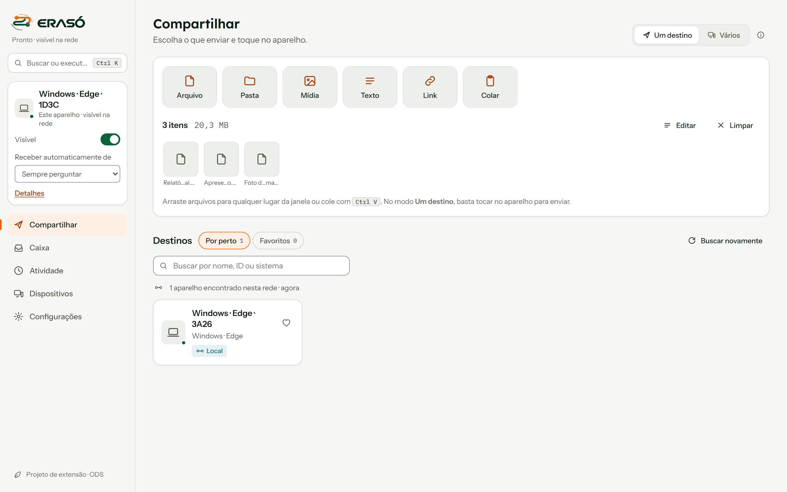
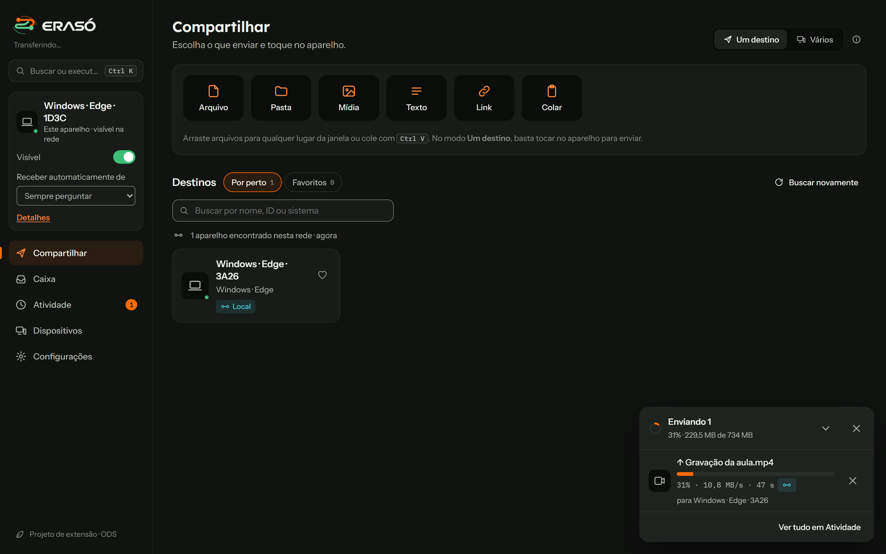
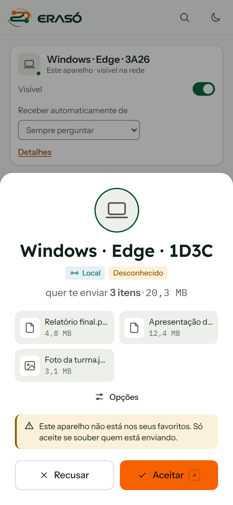

# ERASÓ

> **De uma ponta à outra.**

[](LICENSE)


O ERASÓ envia arquivos, imagens, textos e links entre os seus aparelhos (computador, celular, tablet) **direto de um navegador ao outro**, sem instalar nada e sem passar o conteúdo por nenhum servidor. **Abra o aplicativo nos dois aparelhos: no mesmo Wi-Fi eles se encontram sozinhos. https://eraso.pages.dev/app/** É a alternativa para quem hoje manda arquivo para si mesmo pelo WhatsApp Web.

É um **projeto acadêmico de extensão** ligado à Cruzeiro do Sul Virtual. O [LocalSend](https://github.com/localsend/localsend) é a referência funcional; o ERASÓ leva a mesma ideia para a web.

> **Estado do projeto: protótipo funcional (versão 0.3).** A transferência é real e testada, mas o projeto ainda não passou por uma validação em larga escala. Veja [Limitações](#limitações).

<p align="center">
  
</p>

**Sumário:** [O problema](#o-problema) · [Como funciona](#como-funciona) · [Recursos](#recursos) · [Tecnologias](#tecnologias) · [Como executar](#como-executar) · [Testes](#testes) · [Estrutura](#estrutura-do-repositório) · [Segurança e privacidade](#segurança-e-privacidade) · [Limitações](#limitações) · [Contexto acadêmico](#contexto-acadêmico) · [Contribuir](#contribuir) · [Licença](#licença)

## O problema

Quem usa mais de um aparelho costuma passar arquivos de um para o outro enviando mensagem para si mesmo em aplicativos de conversa, ou usando cabos e serviços de nuvem. Esses caminhos exigem conta, passam o conteúdo por servidores de terceiros e dependem de internet. O ERASÓ propõe um caminho direto: abrir o navegador nos dois aparelhos, escolher o conteúdo e tocar no aparelho de destino.

## Como funciona

```
 Sem servidor (site publicado)                    Com servidor (opcional)

 Aparelho A ── código (QR, link ou texto) ──► B       A ──┐            ┌── B
            ◄──── código de resposta ────────                └─ Servidor ─┘
                                                              (presença e sinalização)

 Depois de apresentados, nos dois modos:
 Aparelho A ◄════ arquivos e textos, direto (WebRTC, criptografado) ════► Aparelho B
```

1. **Apresentação.** Sem servidor, um aparelho gera um **código** (QR Code, link ou texto) com os dados da conexão; o outro o aplica e mostra um código de resposta, que o primeiro lê com a câmera ou cola. Com um servidor do ERASÓ (opcional), os aparelhos aparecem sozinhos na mesma rede ou na mesma sala.
2. Ao enviar, o destino vê um pedido (quem envia e o quê) e aceita, recusa, pula ou renomeia itens. Um PIN opcional é conferido pelo próprio destino.
3. Os bytes seguem **direto entre os dois navegadores**, por um canal WebRTC criptografado (DTLS), com controle de fluxo e conferência de integridade (CRC32).
4. **Nenhum servidor recebe nem guarda** arquivos ou textos. O servidor opcional só conhece nome, tipo e sistema de cada aparelho, na memória, enquanto o aparelho está conectado.

## Capturas

Capturas do aplicativo real, com dois navegadores e uma transferência de verdade em andamento (arquivos de exemplo gerados para a captura).

| Computador, tema escuro: transferência em andamento | Celular, tema claro: pedido de recebimento |
|---|---|
|  |  |

## Recursos

- Enviar arquivos, pastas, mídia, textos e links; um destino ou vários; arrastar e soltar; colar com Ctrl/⌘+V.
- Pedido de recebimento com aceitar, recusar, pular e renomear; recebimento automático opcional.
- PIN opcional; progresso, velocidade e tempo restante reais; cancelamento pelos dois lados.
- Atividade (histórico local), Caixa (itens guardados neste aparelho), favoritos e busca de aparelhos por nome, ID ou sistema.
- Salas com código e link de convite para encontrar aparelhos fora da rede local.
- Diagnóstico de conexão, temas claro/escuro/alto contraste e uso pelo teclado.

## Tecnologias

HTML, CSS e JavaScript puros no navegador (sem framework e **sem `npm install`**); gerador de QR Code próprio e a biblioteca [jsQR](app/vendor/README.md) (Apache-2.0, incluída) para ler QR Codes pela câmera; servidor opcional em **Node.js 18+** (`node:http`, eventos SSE); **WebRTC** (`RTCDataChannel`) para a transferência; `localStorage` e **IndexedDB** para preferências, histórico e Caixa. Os testes controlam navegadores reais (Microsoft Edge) pelo protocolo Chrome DevTools.

## Como executar

### Direto no navegador, sem instalar nada

Abra **<https://eraso.pages.dev/app/>** nos dois aparelhos (computador e celular, por exemplo). **No mesmo Wi-Fi eles aparecem um para o outro sozinhos**: toque no aparelho para enviar. Em redes diferentes, toque em **Criar sala** e abra o link de convite no outro aparelho (ou digite o código de 6 letras).

Se o serviço de apresentação estiver fora do ar ou a rede o bloquear, use o pareamento por QR Code:

1. Em um aparelho, toque em **Parear aparelho › Gerar o meu código**. Aparecem um QR Code, um link e um texto.
2. No outro, aponte a câmera para o QR Code (o ERASÓ abre já com o código) ou use **Tenho um código ou link** e cole o texto. Ele mostra um código de resposta.
3. No primeiro aparelho, use **Ler com a câmera** (ou cole o código de resposta) e **Conectar**.

Pronto: os dois ficam ligados e os arquivos vão direto de um para o outro. A ligação dura enquanto as duas páginas ficarem abertas. A leitura pela câmera exige HTTPS.

### Com servidor, para descoberta automática (opcional)

Requisitos: [Node.js](https://nodejs.org) 18 ou superior. Não há `npm install`.

#### Na rede local (Wi-Fi de casa, por exemplo)

```bash
npm start
```

O terminal mostra os endereços, como `http://192.168.0.12:8780/app/index.html`. **Abra o mesmo endereço em cada aparelho**, no mesmo Wi-Fi. O site institucional fica em `/landing/index.html`.

Se os aparelhos não se encontram, abra **Diagnóstico** no próprio aplicativo. Redes com "isolamento de clientes" (comuns em Wi-Fi de instituições e de visitantes) impedem a conexão direta.

#### Pela internet (modo público)

```bash
npm run start:publico
```

No modo público o servidor aceita a internet, exige um **código de sala** (só quem usa o mesmo código se vê), aplica limites por IP e deve ficar atrás de **HTTPS**. Para aparelhos em redes diferentes, a conexão direta usa STUN e, quando necessário, um servidor TURN. O passo a passo de hospedagem, as variáveis de ambiente e os custos estão em [docs/etapa4/HOSPEDAGEM.md](docs/etapa4/HOSPEDAGEM.md). Modelo das variáveis: [.env.example](.env.example).

## Testes

```bash
npm test
```

São cinco suítes: servidor (salas, autenticação, limites, cabeçalhos, pastas servidas), build do GitHub Pages, camada de rede, interface com dois navegadores reais e ponta a ponta no modo público. Exigem o Microsoft Edge; para outro Chromium, defina `EDGE` com o caminho do executável. Resultados e lacunas: [docs/etapa4/RELATORIO_TESTES.md](docs/etapa4/RELATORIO_TESTES.md). No GitHub, a integração contínua roda a conferência de sintaxe, os testes do servidor e a verificação do site; os testes com navegador rodam localmente.

## Estrutura do repositório

| Pasta | Conteúdo |
|---|---|
| `app/` | Aplicativo web (`index.html`, `app.js`, `rede.js`) |
| `server/` | Servidor de presença e sinalização, que também serve o site e o aplicativo |
| `landing/` | Site institucional (gerado por `landing/tools`) |
| `tests/` | Testes automatizados |
| `docs/design/` | Design system "Revezamento", tokens, movimento e inventário de componentes |
| `docs/etapa3/`, `docs/etapa4/` | Diagnóstico, relatórios e guias de hospedagem |
| `docs/landing/`, `docs/video/` | Documentos de produção do site e do vídeo de demonstração |

## Segurança e privacidade

- Conteúdo trafega direto entre os aparelhos, criptografado; o servidor não o vê.
- Sem contas, sem cookies de rastreamento, sem análise de uso. Preferências e histórico ficam no navegador.
- O servidor publica apenas `landing/` e `app/`, envia cabeçalhos de segurança (CSP, `nosniff` etc.), exige token por aparelho para sinalizar e limita requisições.
- O código da sala é um segredo compartilhado: quem o conhecer entra na sala. Para reportar uma vulnerabilidade, veja [SECURITY.md](SECURITY.md).

## Limitações

- Redes muito restritivas (alguns Wi-Fi corporativos, dados móveis com CGNAT) só conectam com servidor TURN.
- O pareamento por código não é guardado: ao fechar uma das páginas, é preciso parear de novo. Não há "Meus aparelhos".
- O código de convite tem de chegar ao outro aparelho por um canal em que você confie (de preferência, o QR Code pessoalmente).
- O arquivo recebido fica na memória do navegador até terminar; limite de 2 GB por pedido.
- O navegador escolhe a pasta de salvamento; não há aplicativo de computador, bandeja nem inicialização com o sistema.
- Navegadores não revelam o nome da máquina; o nome de fábrica usa modelo ou sistema, navegador e ID.
- Testado automaticamente apenas em Chromium (Edge). Firefox, Safari e celulares reais dependem de validação manual.
- A acessibilidade foi projetada para WCAG 2.2 AA, mas ainda **não passou por auditoria** com leitor de tela.

## Contexto acadêmico

O ERASÓ é desenvolvido como **projeto acadêmico de extensão**, ligado à Cruzeiro do Sul Virtual, e relacionado aos Objetivos de Desenvolvimento Sustentável (ODS). O público a que se destina são estudantes e pessoas com diferentes níveis de familiaridade com tecnologia, por isso a interface é em português, simples e acessível.

| | |
|---|---|
| Instituição | Cruzeiro do Sul Virtual |
| Modalidade | Projeto acadêmico de extensão estudantil |
| Curso | **[a definir]** |
| Disciplina ou programa de extensão | **[a definir]** |
| Orientação docente | **[a definir]** |
| Equipe | **[a definir]** |
| Período de execução | **[a definir]** |
| ODS e metas declarados | **[a definir]**: serão listados só depois de validados com a orientação docente, cada um ligado a uma evidência |

Documentos do projeto: guia de uso, política de privacidade (rascunho) e página de segurança, no site (`landing/`); [histórico de mudanças](CHANGELOG.md) e [documentação técnica](docs/README.md).

## Links oficiais

- Repositório: <https://github.com/SLAYERDLLBR/eraso>
- Site institucional (oficial, Cloudflare Pages): <https://eraso.pages.dev/>
- Aplicativo (oficial): <https://eraso.pages.dev/app/>
- Espelho no GitHub Pages: <https://slayerdllbr.github.io/eraso/> (mesmo conteúdo; aponta o endereço oficial como `canonical`)
- Serviço de apresentação (Cloudflare): `https://eraso-sinal.eraso.workers.dev/saude`. Código em [cloudflare/](cloudflare/README.md).
- Servidor próprio opcional: [docs/etapa4/HOSPEDAGEM.md](docs/etapa4/HOSPEDAGEM.md).

## Publicação do site

O site (`landing/`) e o aplicativo (`app/`) são estáticos e são publicados juntos no GitHub Pages por [`.github/workflows/pages.yml`](.github/workflows/pages.yml), a cada alteração em `main`. O script [`scripts/build-pages.mjs`](scripts/build-pages.mjs) monta a pasta `_site` (`npm run build:pages`) com o site na raiz e o aplicativo em `app/`, aponta os botões para ele e gera `404.html`, `sitemap.xml` e `robots.txt`. O site usa só links relativos, então funciona em `usuario.github.io/eraso/` sem configuração de base. Se um dia houver um servidor do ERASÓ com endereço público, defina a variável de repositório `ERASO_APP_URL` (Settings › Secrets and variables › Actions › Variables) e os botões "Acessar o ERASÓ" passam a apontar para ele. Para usar domínio próprio, adicione um arquivo `landing/CNAME` com o domínio e configure-o em Settings › Pages. Para mover site, aplicativo e serviço para a Cloudflare (com cabeçalhos de segurança reais e domínio próprio), siga [docs/etapa5/MIGRACAO_CLOUDFLARE.md](docs/etapa5/MIGRACAO_CLOUDFLARE.md): `npm run build:cloudflare` já gera o site para a Cloudflare Pages.

## Contribuir

Veja [CONTRIBUTING.md](CONTRIBUTING.md) e o [Código de Conduta](CODE_OF_CONDUCT.md). Problemas e sugestões: abra uma *issue* usando os modelos do repositório.

## Licença

O código do ERASÓ é distribuído sob a **[Apache License 2.0](LICENSE)**. Ela permite usar, copiar, modificar e redistribuir, inclusive para fins comerciais, desde que se mantenham o aviso de licença e o arquivo [NOTICE](NOTICE), e inclui concessão de patentes.

Exceções e avisos:

- **Nome, logotipo e símbolo ERASÓ** não são licenciados pelo arquivo `LICENSE`: os direitos sobre a marca ainda estão por definir. O mesmo vale para o nome e o logotipo da Cruzeiro do Sul Virtual, cujo uso depende de autorização da instituição.
- Partes do site derivam do site do LocalSend, também sob Apache License 2.0; os avisos estão em [landing/THIRD_PARTY_NOTICES.md](landing/THIRD_PARTY_NOTICES.md).
- Titular dos direitos autorais (para a linha de copyright): **[a definir]**.

## Créditos

- Referência funcional: [LocalSend](https://github.com/localsend/localsend) (Apache-2.0). Nenhum código do aplicativo foi reaproveitado.
- Estrutura da landing page adaptada do [site do LocalSend](https://github.com/localsend/website) (Apache-2.0).
- Fontes Instrument Sans, Lexend e IBM Plex Mono (SIL Open Font License 1.1).
- Equipe, orientação docente e período do projeto: **[a definir]** (consulte a página de projeto acadêmico do site).
