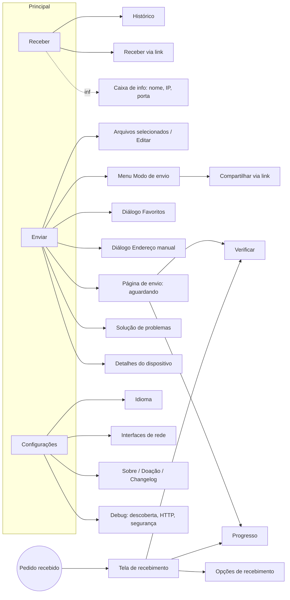
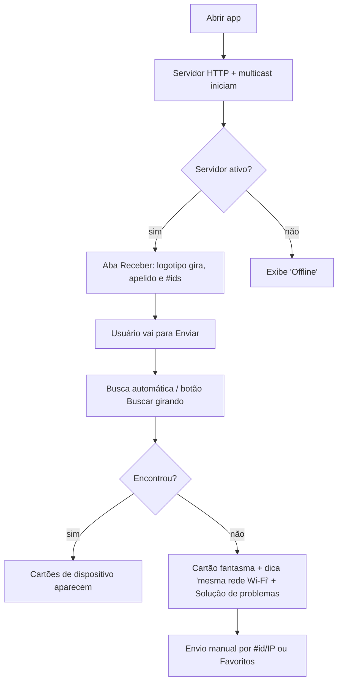
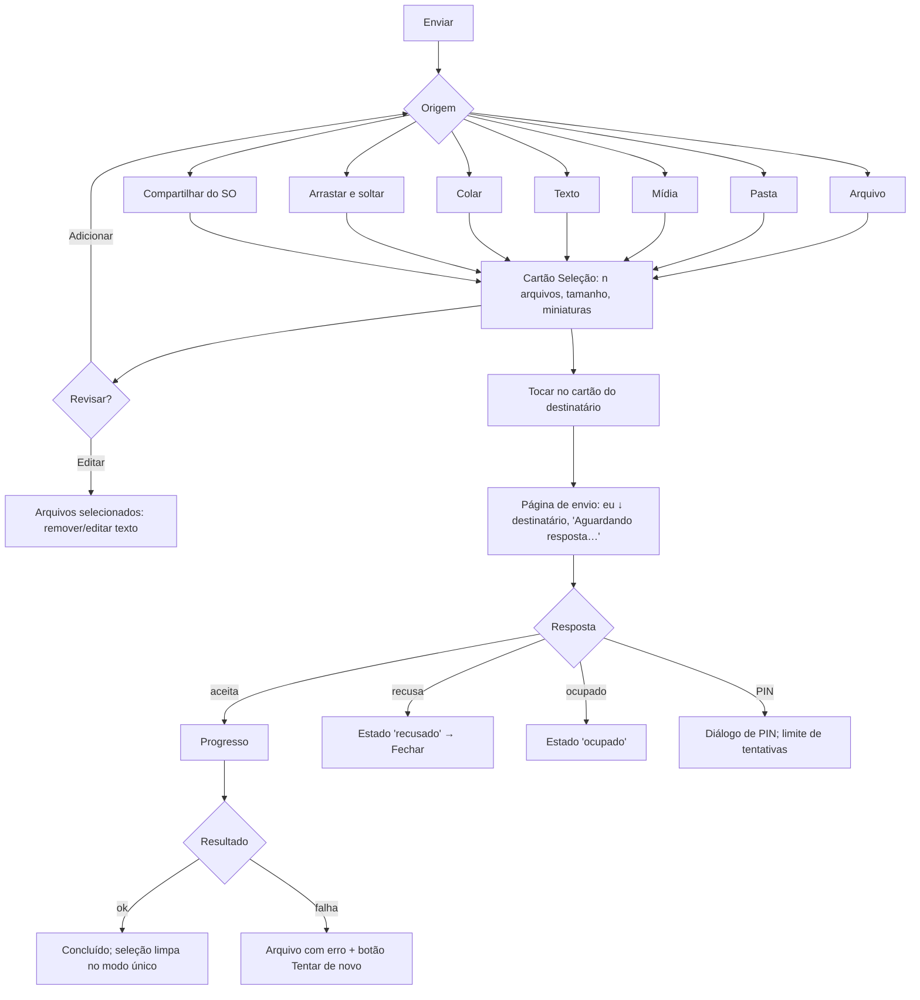
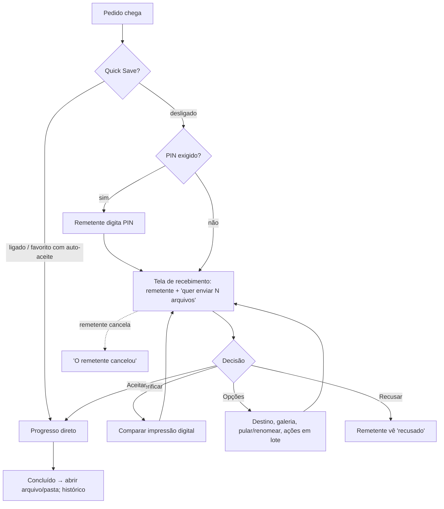
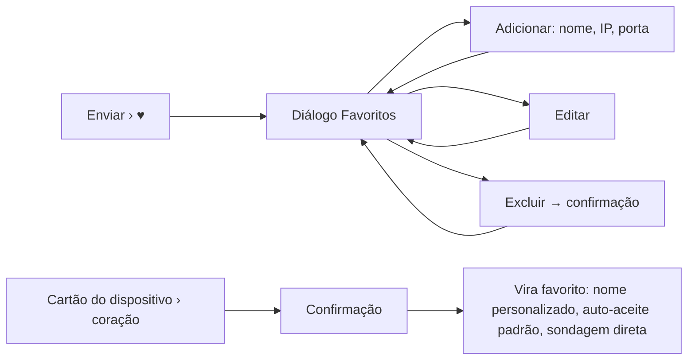
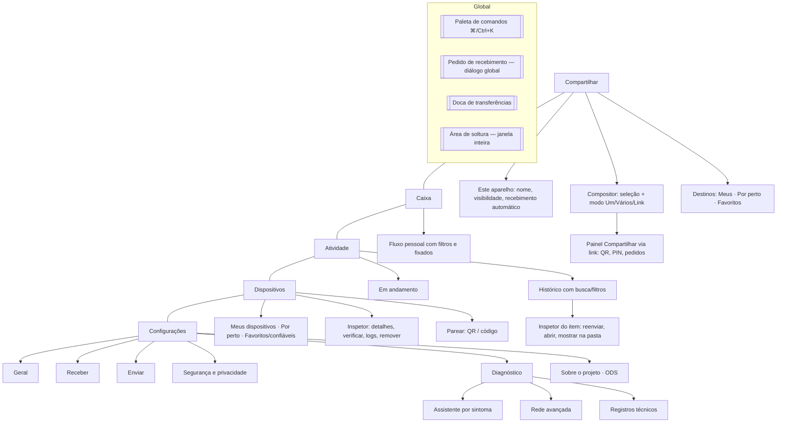

# ADAPTATION_PLAN — do LocalSend ao novo produto

> **Status:** pesquisa e planejamento. Nada foi implementado.
> **Produto:** **Erasó** — "De uma ponta à outra." (nome e logo oficiais recebidos em 01/11/2026).
> **Data da análise:** 01/11/2026 · **Revisão 2:** direção aprovada; sistema sincronizado com a logo oficial.
> **Documentos irmãos:** [DESIGN_SYSTEM.md](DESIGN_SYSTEM.md) · [DESIGN_TOKENS.md](DESIGN_TOKENS.md) · [COMPONENT_INVENTORY.md](COMPONENT_INVENTORY.md) · [MOTION_SPEC.md](MOTION_SPEC.md)

---

## 0. Método, fontes e limitações

### 0.1 Legenda de evidência

Cada afirmação relevante recebe um marcador:

| Marca | Significado |
|---|---|
| **[O]** | **Observado** — visto diretamente no código-fonte, nas strings da interface, no changelog, em capturas oficiais ou no navegador. |
| **[I]** | **Inferido** — fortemente sugerido pela evidência, mas não confirmado executando o app. |
| **[P]** | **Proposto** — decisão de design para o novo produto. |
| **[?]** | **Desconhecido** — não há evidência suficiente. |

Confiança: **alta / média / baixa** quando importante.

### 0.2 Fontes efetivamente consultadas

| Fonte | O que foi extraído |
|---|---|
| Repositório `localsend/localsend` (clone raso, commit `92e133a`, 30/10/2026) — **somente leitura** | Rotas/páginas (`app/lib/pages`), widgets (`app/lib/widget`), tema (`config/theme.dart`), regras responsivas, atalhos (`shortcut_watcher.dart`), modelo de histórico, estados de arquivo, durações de animação, constantes de rede. |
| `app/assets/i18n/en.json` (580 linhas) | Inventário completo de rótulos, diálogos, estados e mensagens — o mapa funcional mais confiável da interface. |
| `app/assets/CHANGELOG.md` (v1.0.0 → 1.18.2 + "Unreleased") | Histórico de funcionalidades, inclusive as dependentes de plataforma. |
| 8 capturas oficiais (`fastlane/metadata/android/en-US/images/phoneScreenshots`) + 2 imagens do site (`hero-desktop.webp`, `screenshot-pc.webp`) | Composição real das telas Receber, Enviar, Recebimento, Progresso, tema escuro, desktop com rail. |
| localsend.org (navegador) | Tipografia e cores do site institucional (Inter; fundo `#F4FBF8`; texto `#05201C`). |
| web.localsend.org (navegador) | **LocalSend Web**: cliente de navegador com apelido, PIN e aviso "apenas dispositivos na mesma rede são exibidos". |
| linear.app, raycast.com, dropbox.com (navegador, estilos computados e variáveis CSS) | Ver [DESIGN_SYSTEM.md §3](DESIGN_SYSTEM.md#3-o-que-cada-referência-ensina). |
| help.dropbox.com (busca) | Semântica dos ícones de sincronização. |

### 0.3 Limitações (registrar sempre)

1. **O aplicativo LocalSend não foi executado.** Os comportamentos vêm do código e das capturas. Microdetalhes de interação (foco por teclado, timings exatos percebidos, gestos) são **[I]**.
2. **As capturas oficiais são mais antigas que o código atual.** Exemplo: as capturas mostram "Quick Save: Off" na aba Receber; no código atual, o Quick Save aparece em **Configurações › Receber**, e a aba Receber exibe o botão "Receive via link". Quando houver conflito, o **código atual** prevalece e a divergência é registrada.
3. **Plataformas não observadas visualmente:** iOS, macOS, Linux, Android TV. Recursos dessas plataformas foram catalogados apenas pelo changelog e pelo código.
4. **Funcionalidades em desenvolvimento:** o repositório contém WebRTC, um servidor de sinalização (`server/`) e uma CLI. Elas aparecem no código, mas a WebRTC **não consta como funcionalidade lançada no changelog** — tratadas como **[I] em desenvolvimento**.
5. **Dropbox:** a aplicação de arquivos exige login; foram analisados o *mockup* oficial do site e a documentação pública. **Linear e Raycast:** analisados pelos sites e pelos *mockups* oficiais do produto exibidos neles, não pelos aplicativos instalados.
6. Nenhum código, ícone, texto ou ativo das referências foi copiado para os entregáveis. Strings do LocalSend aparecem apenas **entre aspas, como evidência**, e não devem ser reaproveitadas.

---

## 1. Análise do LocalSend

### 1.1 Fundamentos técnicos que moldam a experiência

| Aspecto | Evidência | Implicação de design |
|---|---|---|
| Comunicação REST sobre HTTPS; certificado TLS autoassinado gerado em cada dispositivo | README **[O]** | Não há conta nem servidor: identidade = dispositivo. Verificação de impressão digital é o mecanismo de confiança. |
| Descoberta por multicast UDP (`224.0.0.167`), porta padrão `53317`, *timeout* de descoberta 500 ms | `constants.dart` **[O]** | Descoberta é rápida e passiva; falhas costumam ser de rede (firewall, isolamento de AP) — daí a página de solução de problemas. |
| Protocolo v2 com *fallback* v1; detalhes do dispositivo mostram "Protocol v{n}" | changelog 1.9.0, i18n **[O]** | Compatibilidade entre versões aparece para o usuário só em telas avançadas. |
| Canais do dispositivo: badge **"HTTP"** ou **"WebRTC"** no cartão | `device_list_tile.dart` **[O]** | O próprio LocalSend já está preparando um segundo canal de transporte. Valida o nosso conceito de rota local × remota. |
| Servidor de sinalização WebSocket em Rust (`server/`), servidores de sinalização persistidos nas preferências | `AGENTS.md`, `persistence_provider.dart` **[O]** | Conectividade fora da LAN via WebRTC está em construção no LocalSend **[I, confiança média]**. |
| LocalSend Web (`web.localsend.org`): apelido, PIN, "apenas dispositivos na mesma rede são exibidos", suporte ao app nativo "em uma versão futura" | navegador **[O]** | Existe um precedente de cliente web; hoje ele só conversa com outros navegadores. |
| Tipos de dispositivo: `mobile`, `desktop`, `web`, `headless`, `server` (ícones: smartphone, computer, language, terminal, dns) | `device.dart`, `device_type_ext.dart` **[O]** | Ícone por tipo é a principal pista de identificação. |
| CLI interativa (1.18.0) | changelog **[O]** | Fora do escopo visual; registra que o produto aceita uso "sem interface". |

### 1.2 Estrutura e navegação

**[O]** A aplicação tem **três destinos principais**, na ordem: **Receber** (ícone Wi-Fi), **Enviar** (ícone avião de papel), **Configurações** (engrenagem).

**Regras responsivas [O]** (`responsive_builder.dart`, `home_page.dart`):

| Largura | Navegação | Observação |
|---|---|---|
| < 700 px (`isMobile`) | Barra inferior (`NavigationBar`) | Padrão celular. |
| ≥ 700 px | `NavigationRail` compacto (só ícones) | Tablet / janela estreita. |
| ≥ 800 px (`isDesktop`) | Rail **estendido** com logotipo "LocalSend" e rótulos | Desktop. |
| Conteúdo | Largura máxima **600 px**, centralizado (`ResponsiveListView.defaultMaxWidth`) | Em telas largas, sobra muito espaço lateral (ver capturas desktop). |

**Arrastar e soltar [O]:** a janela inteira é uma área de soltura; ao arrastar, aparece uma sobreposição com o texto "Place items to share." e, ao soltar, o app muda para a aba Enviar (pastas e arquivos misturados são aceitos desde 1.18.2).

### 1.3 Inventário de telas

| Tela | Propósito | Elementos-chave | Evidência |
|---|---|---|---|
| **Receber** (aba) | Mostrar que este dispositivo está visível e como ele se chama | Logotipo girando (15 s/volta) enquanto o servidor está ativo; apelido em 48 px; identificadores `#NN` derivados do IP em 24 px (ou "Offline"); botão "Receive via link"; canto superior direito: Histórico e Info (abre caixa com nome, IP, porta) | `receive_tab.dart`, captura 1 e 6 **[O]** |
| **Enviar** (aba) | Selecionar conteúdo e escolher destinatário | Seção "Selection" com botões grandes (File, Folder, Media, Text, App*, Paste); cartão de seleção (contagem, tamanho total, miniaturas horizontais, Editar, Adicionar, limpar); "Nearby devices" + ações (buscar, envio manual, favoritos, modo de envio); lista de dispositivos; "Troubleshoot"; dicas alternadas | `send_tab.dart`, capturas 2, 5, 7 **[O]** |
| **Configurações** (aba) | Ajustes | Seções Geral, Receber, Enviar, Rede, Outros; "Advanced settings" alterna itens avançados (estado persistido desde 1.16.0) | `settings_tab.dart` **[O]** |
| **Página de envio** | Aguardar a resposta do destinatário | Cartão do remetente → seta ↓ → cartão do destinatário; "Waiting for response…"; estados: recusado, ocupado, tentativas de PIN excedidas, calculando *checksum* (n/N); Cancelar; Verificar | `send_page.dart`, captura 8 **[O]** |
| **Recebimento** | Aceitar ou recusar um pedido | Ícone do remetente, apelido grande, badges (`#id`, modelo); "wants to send you N files" / "sent you a message:" / "sent you a link:"; Verificar; Opções; **Recusar** (vermelho) / **Aceitar** (cor primária); para mensagens: Copiar, Abrir (link), Fechar | `receive_page.dart`, captura 3 **[O]** |
| **Opções de recebimento** | Ajustar antes de aceitar | Pasta de destino (editar); salvar mídia na galeria (desliga sozinho se houver pastas); lista de arquivos com pular/renomear por item; Ações rápidas (renomear em lote: contador, prefixo, zeros à esquerda, ordenar A–Z, aleatório); Desfazer | `receive_options_page.dart`, i18n **[O]** |
| **Progresso** | Acompanhar a transferência | Título "Sending/Receiving files"; pasta de destino (abre a pasta); linhas por arquivo: miniatura, nome (tamanho), status (Fila, Pulado, Erro, Concluído) ou barra; "Saved in Photos"; **botão de nova tentativa por arquivo com falha** (lado do envio); cartão de total: "Total progress (tempo restante)", barra, "Advanced" (arquivos n/N, tamanho, velocidade), Cancelar → Concluído | `progress_page.dart`, capturas 4 e 8, *hero* desktop **[O]** |
| **Arquivos selecionados** | Revisar a seleção antes de enviar | Lista; remover; editar mensagem de texto; "Delete all" | i18n, changelog 1.8.0 **[O]** |
| **Histórico** | Consultar o que foi recebido | Entradas (nome, tipo, caminho, salvo na galeria, é mensagem, tamanho, apelido do remetente, data); ações por item: Abrir arquivo, Mostrar na pasta, Informações, Excluir do histórico; Abrir pasta; Excluir histórico (com confirmação); estado vazio | `receive_history_page.dart`, `receive_history_entry.dart` **[O]** |
| **Detalhes do dispositivo** | Inspecionar um par | Nome, endereço, versão, protocolo; Favoritar; Verificar; *logs* "Discovered/Updated via {protocol} ({host})" | i18n **[O]** |
| **Verificar** | Confirmar identidade criptográfica | Alternância Ícones / Texto; pergunta "Does it look the same on the other device?"; impressão combinada dos dois certificados | `verify_page.dart` **[O]** |
| **Compartilhar via link** | Enviar para quem não tem o app | Inicia servidor; lista de links; QR Code; ampliar URL; PIN obrigatório (opcional); criptografia; aceitar automaticamente; lista de pedidos pendentes com aceitar/recusar | `web_share_page.dart`, i18n **[O]** |
| **Receber via link** | Receber de quem não tem o app (navegador envia) | Página web servida pelo app; arrastar e soltar no navegador (1.18.2); páginas web personalizáveis no desktop | changelog 1.18.0–1.18.2 **[O]** |
| **Solução de problemas** | Diagnóstico guiado | 3 cartões sintoma → solução: firewall (com "Fix automatically"/"Open Firewall"), não descobre outros, nenhum dos dois se vê (isolamento de AP) | `troubleshoot_page.dart`, i18n **[O]** |
| **Interfaces de rede** | Restringir interfaces | Prévia; lista de permissões / bloqueios; exige reiniciar o servidor | i18n, changelog 1.17.0 **[O]** |
| **Debug** | Diagnóstico avançado | Descoberta, logs HTTP, segurança | `pages/debug/*` **[O]** |
| Idioma, Novidades, Changelog, Sobre, Contribuidores, Tradutores, Empacotadores, Doação, Seletor de APK | Auxiliares / institucionais | — | `pages/*` **[O]** |

### 1.4 Catálogo funcional (roteiro do briefing verificado)

Status: ✅ existe · ◐ parcial/dependente de plataforma · ✖ não encontrado.

| Funcionalidade | Status | Plataforma / versão | Evidência e observações |
|---|---|---|---|
| Descoberta automática de dispositivos | ✅ | todas · 1.0; multicast 1.7.0; resposta TCP 1.8.0 | Botão de busca com ícone girando (2 s/volta); tocar limpa a lista e busca de novo (1.11.0); varre todas as interfaces se < 3; *threads* separadas (1.15.2) **[O]** |
| Seleção de destinatário | ✅ | todas | Tocar no cartão do dispositivo inicia o envio (modo único) **[O]** |
| Envio para vários dispositivos | ✅ | todas · 1.8.0 | Modo "Multiple recipients": envio paralelo; seleção **não** é limpa ao terminar **[O]** |
| Recebimento de arquivos | ✅ | todas | — |
| Aprovar / recusar | ✅ | todas · aceitar parcialmente 1.5.0 | Recusar/Aceitar; pular arquivos individualmente **[O]** |
| Aceitação automática ("Quick Save") | ✅ | 1.5.0 | Aviso: qualquer pessoa na rede local pode enviar **[O]** |
| Aceitação automática de favoritos | ✅ | 1.16.0; **ativo por padrão** em 1.18.0 | "Quick Save for Favorites" **[O]** |
| Favoritos | ✅ | 1.12.0 | Diálogo com lista; adicionar manualmente (nome, IP, porta); editar; excluir com confirmação; coração no cartão com confirmação (1.15.0); nome do favorito exibido na lista (1.13.0); favoritos são sondados ativamente **[O/I]** |
| Arquivos | ✅ | todas | Seletor de arquivos; arrastar e soltar 1.2.0 **[O]** |
| Pastas | ✅ | 1.9.0 | "Add folder" inclui a própria pasta (1.9.1); galeria desligada se houver pastas **[O]** |
| Mídia (galeria) | ✅ | Android/iOS | Seletor próprio com seleção por gesto (1.17.0) **[O]** |
| Textos | ✅ | 1.2.0 | Diálogo de mensagem multilinha; editável na seleção **[O]** |
| Links | ✅ | 1.4.0 | Mensagem detectada como link vira botão "Abrir"; qualquer URI vale (1.15.4) **[O]** |
| Apps (APK) | ◐ | Android | Seletor de APK com filtros **[O]** |
| Área de transferência (colar) | ◐ | desktop 1.12.0; Android/iOS 1.16.0 | Botão "Paste"; Ctrl/⌘+V muda para Enviar; imagem colada vira PNG no Windows **[O]** |
| QR Code | ◐ | 1.9.0 | **Apenas no compartilhamento via link** (URL do servidor local). **Não há pareamento de dispositivos por QR** **[O]** |
| Compartilhar via link | ✅ | 1.9.0; HTTPS 1.11.0; auto-aceitar 1.14.0; PIN 1.15.0 | — |
| Receber via link | ✅ | 1.18.0 | — |
| PIN | ✅ | 1.15.0 | Exigir PIN ao receber; exigir PIN no link; limite de tentativas **[O]** |
| Verificação de identidade | ✅ | 1.18.x (atual) | Impressão digital em ícones ou texto **[O]** |
| *Checksums* | ✅ | 1.18.0 (padrão ligado) | Criar ao enviar / verificar ao receber **[O]** |
| Endereço manual | ✅ | 1.3.0; recentes 1.7.0 | "Hashtag" (final do IP) ou IP; recentes **[O]** |
| Histórico | ◐ | 1.7.0; mensagens 1.15.0; 30 itens 1.15.3 | **Só recebimentos**; limite de 30 entradas; pode ser desativado **[O]** |
| Reenvio de falhas | ◐ | 1.15.4 | Botão por arquivo **durante/após a sessão** de envio; **não existe reenvio a partir do histórico** **[O]** |
| Arquivos duplicados | ✅ | 1.13.0 / 1.18.0 | Duplicatas ignoradas na seleção; ao salvar, renomeia "arquivo (1).txt" **[O]** |
| Renomear ao receber | ✅ | 1.5.0 | Individual e em lote **[O]** |
| Progresso e velocidade | ✅ | — | Por arquivo + total; tempo restante; velocidade no "Advanced" **[O]** |
| Limpar seleção | ✅ | 1.15.0 | Botão ✕; limpa sozinho no modo único **[O]** |
| Concluir automaticamente | ✅ | 1.13.0 | Com pequeno atraso (1.13.1) **[O]** |
| Destino / galeria | ✅ | — | Pasta padrão Downloads; "salvar mídia na galeria" (móvel) **[O]** |
| Segundo plano | ◐ | Android 1.18.0 | iOS exige app em primeiro plano **[O]** |
| Inicialização automática | ◐ | Windows, macOS, Linux | + "iniciar oculto" **[O]** |
| Bandeja / barra de menus | ◐ | desktop | Minimizar para a bandeja ao fechar **[O]** |
| Integração com o SO | ◐ | Windows: "Enviar para" (1.15.0), folha de compartilhamento (1.18.0); macOS: extensão de compartilhamento, soltar no ícone do Dock/barra de menus, ícone com estado de erro/sucesso; Android: *intent* de compartilhamento, bloco de Configurações rápidas; desktop: progresso na barra de tarefas, arquivos por argumento de linha de comando | changelog **[O]** |
| Atalhos de teclado | ◐ | desktop | Esc volta; Ctrl/⌘+V cola; Ctrl+Q sai (Linux); ⌘+, abre configurações (macOS); ⌘+W fecha janela (macOS, 1.13.0) **[O]**. **Não há** paleta de comandos nem atalhos para navegação entre abas **[O, ausência]** |
| Personalização | ✅ | — | Tema sistema/claro/escuro; cor: sistema (Material You), LocalSend, OLED, Yaru, personalizada (seletor, 1.18.0); idioma; animações liga/desliga; nome (do sistema ou aleatório), tipo e modelo do dispositivo **[O]** |
| Rede avançada | ✅ | — | Porta, filtro de interfaces, *timeout* de descoberta, criptografia, multicast — com avisos quando diferem do padrão **[O]** |
| Diagnóstico | ✅ | — | Solução de problemas + interfaces + debug + *logs* por dispositivo **[O]** |
| Sempre no topo, salvar posição da janela, mostrar no menu de contexto | ◐ | desktop | **[O]** |
| Manter tela ligada durante a transferência | ✅ | 1.5.0; libera o *wake lock* ao terminar (1.18.0) | **[O]** |
| Animações respeitam a preferência do sistema | ◐ | Android, iOS, macOS · 1.18.0 (na primeira execução) | **[O]** |

### 1.5 Interface e experiência — leitura visual

| Dimensão | O que existe no LocalSend | Leitura |
|---|---|---|
| **Identidade** | Material 3 com cor-semente **teal**; logotipo de círculo sólido cercado por anel tracejado; nomes aleatórios "Adjetivo + Fruta" | Amigável e neutra; a personalidade vem dos apelidos e do logotipo girando **[I]** |
| **Paleta** | `ColorScheme.fromSeed(Colors.teal)`; superfícies claras esverdeadas; `secondaryContainer` em botões grandes, *badges* e campos; laranja (`Colors.orange`) como "aviso"; vermelho no botão Recusar | Paleta derivada de sistema, sem *tokens* próprios **[O]** |
| **Tipografia** | Fonte do sistema (Segoe UI Variable no Windows, Noto Sans no Linux, Roboto/SF nos demais); apelido 48 px, `#id` 24 px; nomes de dispositivo 20 px; nome de arquivo 16 px | Hierarquia simples, quase sem variação de peso **[O]** |
| **Espaçamento** | Valores soltos: 5, 10, 15, 20, 30 px | Ritmo de 5 px, sem escala formal **[O]** |
| **Raios** | 5 px (campos, *badges*); 10 px (cartões, botões grandes, barras de progresso) | **[O]** |
| **Densidade** | `VisualDensity.standard` em todas as plataformas ("desktop igual ao celular") | Desktop pouco denso; coluna de 600 px **[O]** |
| **Componentes** | Cartões de dispositivo, botões grandes de seleção (90–100 × 65 px), *badges*, barra de progresso de 10 px, diálogos Material, *bottom sheets* no celular | **[O]** |
| **Ícones** | Material Icons (preenchidos): wifi, send, settings, history, info, sync, ads_click, favorite, verified_user, check_circle, close, refresh | **[O]** |
| **Estados vazios** | Cartão de dispositivo "fantasma" semitransparente; "The history is empty."; "No favorite devices yet."; "No requests yet." | Discretos, sem ilustração **[O]** |
| **Carregamento** | Ícone de busca girando; "Starting server…"; diálogo de carregamento; "Calculating checksum (n / N)" | **[O]** |
| **Erros** | Diálogos (sem permissão, rede local, arquivo não abre, indisponível nesta plataforma); estados na página de envio (recusado, ocupado, PIN); "Finished with error"; ícone de aviso por arquivo | Mensagens claras e específicas — ponto forte **[O]** |
| **Sucesso** | "Done" por arquivo; "Finished"; *snackbar* "Copied to Clipboard"; ícone do Dock com estado (macOS) | **[O]** |
| **Conexão** | "Offline" no lugar do identificador; servidor "(Offline)" nas configurações; aviso "reinicie o servidor" | **[O]** |
| **Animações** | *Fade* inicial 300 ms com atrasos de 200–500 ms; deslizamento `easeOutCubic`; opacidade/cross-fade 200 ms; logotipo girando 15 s; ícone de busca 2 s; interruptor global para desligar | Movimento funcional e contido **[O]** |
| **Responsivo / desktop × celular** | Barra inferior ↔ rail; diálogo no desktop × *bottom sheet* no celular para "Adicionar" (1.6.0); botões de seleção com rolagem horizontal no celular (largura sugere rolagem, 1.15.4) | **[O]** |

### 1.6 Fluxos completos

> Diagramas descrevem o LocalSend **como observado** no código e nas capturas. Etapas marcadas [I] não foram confirmadas executando o app.

**F1 — Abrir e localizar dispositivos**

Decisões: buscar de novo, envio manual, abrir solução de problemas. Feedback: rotação do ícone, cartões, dicas alternadas.

**F2 — Selecionar arquivos e enviar** · **F3 — Escolher destinatário**

**F4 — Receber e aprovar**

Para **texto/link**: a tela mostra o conteúdo com Copiar / Abrir / Fechar, sem progresso.

**F5 — Enviar para vários** — Menu *Modo de envio* → "Multiple recipients" → cada toque em um dispositivo dispara um envio paralelo; os cartões mostram barra de progresso embutida; a seleção é mantida **[O]**.

**F6 — Textos e links** — Enviar › Texto → diálogo multilinha → seleção mostra o texto → destinatário → o receptor vê "enviou uma mensagem/um link" com Copiar e Abrir; mensagens vão para o histórico (1.15.0) **[O]**.

**F7 — Consultar histórico** — Receber › ícone Histórico → lista (até 30) → ações por item (abrir, mostrar na pasta, info, excluir) → Abrir pasta / Excluir tudo (confirmação) **[O]**.

**F8 — Reenviar** — Somente na tela de Progresso, durante/após a sessão: arquivo com falha → botão de atualizar → nova tentativa **[O]**. Depois que a sessão é fechada, **não há como reenviar** **[O, ausência]**.

**F9 — Favoritos**

**F10 — Segurança e privacidade** — Configurações › Receber (Quick Save, Quick Save de favoritos, exigir PIN, *checksums*, salvar no histórico) · Enviar (auto-aceitar no link, criar *checksums*) · Rede (criptografia — desligar mostra aviso de HTTP sem criptografia) · por par: Verificar impressão digital **[O]**.

**F11 — Diagnosticar conexão** — Enviar › "Troubleshoot" → cartões Sintoma/Solução → "Corrigir automaticamente" (firewall, quando a plataforma permite) ou instruções → se necessário: Configurações › Interfaces de rede, porta, multicast (com avisos) → Detalhes do dispositivo › *logs* **[O]**.

### 1.7 Pontos fortes e fricções (leitura de design)

| Pontos fortes a preservar | Fricções a resolver |
|---|---|
| Caminho mais curto possível: seleção → toque no dispositivo. | A identidade do aparelho (Receber) e o envio (Enviar) ficam em abas separadas, embora o uso real seja contínuo **[I]**. |
| Nada de conta, cadastro ou nuvem: privacidade por padrão. | Funciona só na mesma rede (exceto WebRTC em desenvolvimento). |
| Pedido de recebimento explícito, com remetente identificado. | Histórico só de recebidos, limitado a 30, sem busca nem filtros. |
| Mensagens de erro específicas e solução de problemas guiada. | Reenvio só dentro da sessão. |
| Personalização ampla sem poluir a tela principal ("Advanced"). | Desktop com coluna de 600 px e muito espaço vazio; ações importantes escondidas atrás de ícones sem rótulo (buscar, manual, favoritos, modo) **[I]**. |
| Integração profunda com o SO. | Sem paleta de comandos e com poucos atalhos. |
| Apelidos aleatórios fáceis de reconhecer. | Modo de envio fica num menu de engrenagem pouco descobrível **[I]**. |

---

## 2. Matriz de adaptação

### A. Reproduzir conceitualmente (preservar, com identidade própria)

| # | Do LocalSend | No novo produto **[P]** |
|---|---|---|
| A1 | Descoberta automática na LAN + busca manual | Mesma lógica; o "radar" vira o painel **Por perto** com pulso discreto ([MOTION_SPEC §5](MOTION_SPEC.md#5-descoberta-de-dispositivos)). |
| A2 | Identidade do dispositivo (apelido + tipo + identificador curto) | Apelido gerado em pt-BR com vocabulário próprio (fauna e flora brasileiras + adjetivo, ex.: "Ipê Sereno") — reforça o vínculo com o ODS 15 sem copiar o padrão "Adjetivo + Fruta". |
| A3 | Seleção → toque no destinatário = envio | Mantido como gesto principal (1 clique para enviar após selecionar). |
| A4 | Fontes de conteúdo: arquivo, pasta, mídia, texto, colar, arrastar, compartilhar do SO | Mantidas; no desktop, a área de soltura é a janela toda. |
| A5 | Pedido de recebimento com Aceitar/Recusar, remetente destacado | Mantido como diálogo/folha global, com pré-visualização do conteúdo. |
| A6 | Aceitar parcialmente, pular e renomear arquivos, renomeação em lote | Mantido dentro do painel "Opções" do pedido. |
| A7 | Quick Save (desligado / favoritos / todos) | Mantido como **"Recebimento automático"** com três níveis e aviso de risco no nível "todos". |
| A8 | PIN de recebimento e PIN no link | Mantido. |
| A9 | Verificação por impressão digital (ícones/texto) | Mantido e promovido: obrigatório no **pareamento** de "Meus dispositivos" remotos. |
| A10 | *Checksums*, criptografia, avisos ao desativar | Mantido; criptografia **não** desativável na interface padrão (ver C/descarte parcial). |
| A11 | Progresso por arquivo + total, velocidade, tempo restante | Mantido; velocidade e rota visíveis sem precisar abrir "Avançado". |
| A12 | Modos de envio: único, múltiplo, via link | Mantidos, mas como seletor visível (ver B3). |
| A13 | Compartilhar e receber via link (navegador de terceiros) + QR | Mantido; o QR também serve para pareamento (C). |
| A14 | Tratamento de duplicados ("nome (1).ext") e saneamento de nomes | Mantido. |
| A15 | Solução de problemas por sintoma, com correção automática quando possível | Mantido dentro de **Diagnóstico**. |
| A16 | Integração com o SO (bandeja, iniciar com o sistema, iniciar oculto, menu de contexto, folha de compartilhamento, progresso na barra de tarefas) | Mantida no app desktop; no web, equivalentes possíveis (PWA *share target*, notificações) — ver dúvidas técnicas. |
| A17 | Tema claro/escuro/sistema, idioma, animações liga/desliga | Mantido; "animações" respeita `prefers-reduced-motion` por padrão. |
| A18 | Ajustes de rede avançados (porta, interfaces, multicast, *timeout*) | Mantidos sob "Avançado" em Diagnóstico › Rede. |
| A19 | Manter tela ligada durante a transferência; concluir automaticamente | Mantidos. |

### B. Melhorar e reorganizar

| # | Situação no LocalSend | Proposta **[P]** | Princípio |
|---|---|---|---|
| B1 | Receber e Enviar em abas separadas | Uma única tela **Compartilhar**: identidade/visibilidade deste aparelho no topo, compositor de seleção e grade de destinos. "Receber" vira **estado** (visível/oculto/automático) + pedido global. | Menos navegação (LocalSend) |
| B2 | Ações de destino como ícones sem rótulo | Barra de destinos com rótulos: *Buscar novamente*, *Adicionar por endereço*, *Favoritos* como filtro, *Parear dispositivo*. | Clareza (Linear) |
| B3 | Modo de envio escondido num menu | Controle segmentado visível no compositor: **Um destino · Vários · Link**. | Descobribilidade |
| B4 | Histórico só de recebidos, 30 itens, sem busca | **Atividade**: histórico unificado (enviados + recebidos + caixa pessoal), busca, filtros por tipo/dispositivo/rota/status, agrupamento por dia, sem limite fixo (retenção configurável). | Organização (Dropbox) |
| B5 | Reenvio só durante a sessão | Reenviar a partir de qualquer item do histórico com falha ou concluído ("Enviar de novo"), se os arquivos ainda existirem. | Continuidade |
| B6 | Progresso ocupa a tela inteira | **Doca de transferências** persistente (canto inferior no desktop, folha no celular) + página de detalhe; o usuário continua navegando. | Não bloquear (Dropbox) |
| B7 | Configurações numa lista longa com "Avançado" | Seções com âncoras e busca; **Segurança e privacidade** agrupada; Diagnóstico separado. | Hierarquia (Linear) |
| B8 | Detalhes do dispositivo em página separada | **Inspetor lateral** (desktop) / folha (celular) com detalhes, verificação, *logs* e ações. | Lista + detalhe (Raycast, Linear) |
| B9 | Atalhos mínimos | **Paleta de comandos** (Ctrl/⌘+K) + atalhos documentados e exibidos nas dicas. | Produtividade (Raycast) |
| B10 | Coluna de 600 px no desktop | Layout em três regiões (navegação · conteúdo · inspetor) a partir de 1280 px. | Uso do espaço (Raycast) |
| B11 | Favoritos num diálogo modal | Favoritos e confiáveis viram propriedades do dispositivo, com filtro na grade e gestão em **Dispositivos**. | Evitar duplicação |
| B12 | Estados de conexão textuais ("Offline") | Indicador de rota e presença em todo cartão: **Local**, **Remoto**, **Offline (visto há…)**, com ícone + texto. | Feedback de estado (Dropbox) |
| B13 | Estados vazios minimalistas | Estados vazios que ensinam o próximo passo (ex.: "Nenhum aparelho por perto — confira se estão no mesmo Wi-Fi · Diagnosticar"). | Acessibilidade para iniciantes |

### C. Expandir (novo)

| # | Recurso | Descrição **[P]** | Dependências |
|---|---|---|---|
| C1 | **Meus dispositivos (remotos)** | Aparelhos próprios pareados por QR/código + verificação; ficam visíveis mesmo em redes diferentes. | Sinalização/relay; identidade de usuário ou chave de pareamento |
| C2 | **Rota local com *fallback* remoto** | Tenta LAN direta; se indisponível, oferece/usa rota remota (P2P via internet; relay como último recurso). A rota escolhida é sempre visível e pode ser trocada. | WebRTC/STUN/TURN ou equivalente |
| C3 | **Caixa pessoal** | Fluxo cronológico de conteúdos enviados "para mim": textos, links, imagens, arquivos; fixar, copiar, baixar, excluir, expiração. Acessível em qualquer aparelho do usuário. | Armazenamento temporário (cifrado de ponta a ponta) |
| C4 | **Histórico unificado** | Ver B4; inclui rota, duração, velocidade média, dispositivo de origem/destino. | Persistência local + sincronização opcional |
| C5 | **Acesso entre aparelhos** | Conteúdo da Caixa disponível em qualquer aparelho pareado; downloads sob demanda. | C1 + C3 |
| C6 | **Continuidade de transferência** | Retomar transferências interrompidas a partir do último bloco confirmado, quando o protocolo permitir; senão, reenviar com 1 clique. | Protocolo com *chunks* (viabilidade a confirmar) |
| C7 | **Paleta de comandos** | Ações, dispositivos, itens recentes e ajustes acessíveis pelo teclado. | — |
| C8 | **Pré-visualização rica** | Miniaturas de imagem/vídeo/PDF, *preview* de link (título/domínio), texto com "copiar". | Geração local de miniaturas |
| C9 | **Seção institucional enxuta (ODS)** | "Sobre o projeto" em Configurações + selo discreto no rodapé da navegação + 1 cartão no primeiro uso. | Conteúdo do projeto de extensão |
| C10 | **Primeiro uso guiado** | 3 passos: nomear o aparelho → entender visibilidade → (opcional) parear outro aparelho por QR. | — |

### Funcionalidades **não** incorporadas e por quê

| Item do LocalSend | Decisão | Justificativa |
|---|---|---|
| Comunidade, Sobre o LocalSend, Contribuidores, Tradutores, Empacotadores, Doação, Restaurar compra | **Descartar** | Institucionais do projeto de origem; fora do escopo definido no briefing (§2.1). Substituídos por "Sobre o projeto" (C9). |
| Changelog e "Novidades" | **Adaptar** (não descartar) | Útil para usuários, mas fora da navegação principal: item em Configurações › Sobre + aviso único após atualização. |
| Seletor de APK (Android) | **Adiar** | Plataformas-alvo são web e desktop; reavaliar se houver app Android. |
| Tema Yaru e modo de cor Material You | **Descartar** | Identidade visual própria é requisito; mantemos claro/escuro/sistema e alto contraste. Tema por cor personalizada fica como P3 opcional (risco de contraste). |
| "Modo OLED" | **Adaptar** | Vira variante "escuro profundo" apenas se houver demanda; o tema escuro proposto já é quase preto. |
| Desativar criptografia (modo HTTP de *debug*) | **Restringir** | Pode existir só como *flag* de desenvolvedor; não aparece para estudantes (risco de segurança). |
| Páginas de *debug* | **Adaptar** | Viram "Registros técnicos" dentro de Diagnóstico › Avançado. |
| Personalização das páginas web por arquivos HTML locais | **Adiar** | Recurso de nicho; sem impacto no fluxo principal. |
| Android TV (navegação por controle remoto) | **Adiar** | Fora das plataformas-alvo; a acessibilidade por teclado cobre parte do requisito. |

---

## 3. Nova arquitetura de navegação

### 3.1 Mapa

### 3.2 O que é tela, seção, painel ou componente

| Elemento do briefing | Forma | Justificativa |
|---|---|---|
| **Dispositivos** | **Tela** (gestão) + **seção** na tela Compartilhar (seleção) | Selecionar ≠ gerenciar. A seção mostra destinos; a tela gerencia pareamento, confiança e diagnóstico por aparelho. |
| **Enviar** | **Tela "Compartilhar"** (início) | É a ação principal; não precisa de nome de verbo isolado. |
| **Receber** | **Componente** (cartão "Este aparelho") + **diálogo global** (pedido) | Receber é passivo; o LocalSend dedica uma aba a mostrar o próprio nome. Aqui, a identidade fica sempre à vista no topo da tela inicial. |
| **Caixa pessoal** | **Tela** | Conceito novo e central para substituir o "mandar para mim mesmo" do WhatsApp Web. |
| **Transferências** | **Componente global** (doca) + **seção** "Em andamento" em Atividade | Não bloquear a navegação. |
| **Histórico** | **Seção** de Atividade | Unificado com transferências: um só lugar para "o que aconteceu". |
| **Arquivos** | **Filtro** em Atividade e Caixa (não tela) | Uma tela "Arquivos" duplicaria Atividade/Caixa; o produto não é armazenamento em nuvem. |
| **Favoritos** | **Filtro** + propriedade do dispositivo | Evita o diálogo modal e a duplicação. |
| **Configurações** | **Tela** com seções | — |
| **Diagnóstico de conexão** | **Seção** de Configurações + **atalho contextual** nos estados vazios/erros | Acessível onde o problema acontece. |
| **Sobre o projeto (ODS)** | **Seção** de Configurações + selo no rodapé + cartão no primeiro uso | Discreto, sem virar portal. |

### 3.3 Navegação por plataforma

| Contexto | Navegação |
|---|---|
| Celular / web estreita (< 600 px) | Barra inferior com 5 destinos (rótulo sempre visível); doca vira folha inferior recolhível; inspetor vira folha. |
| Tablet / janela média (600–959 px) | Rail de ícones com rótulos curtos; sem inspetor fixo. |
| Desktop (≥ 960 px) | Barra lateral com rótulos, cartão "Este aparelho" fixo no topo da barra. |
| Desktop amplo (≥ 1280 px) | + inspetor à direita (360 px). |

---

## 4. Prioridades

| Prioridade | Escopo | Critério |
|---|---|---|
| **P0 — núcleo LocalSend** | Logo oficial em SVG com versões colorida e invertida; descoberta LAN; identidade do aparelho; seleção (arquivo, pasta, texto, link, colar, arrastar); envio único; pedido Aceitar/Recusar; progresso; histórico básico unificado; erros específicos; tema claro/escuro; acessibilidade AA | Sem isso o produto não substitui o LocalSend. |
| **P1 — diferencial do projeto** | Caixa pessoal; Meus dispositivos com pareamento QR + verificação; rota remota com *fallback*; doca de transferências; envio múltiplo; recebimento automático (3 níveis); PIN; Diagnóstico por sintoma; Sobre o projeto (ODS) | Atende à proposta "substituir o WhatsApp Web". |
| **P2 — produtividade** | Paleta de comandos e atalhos; busca e filtros em Atividade; reenviar do histórico; inspetor lateral; opções de recebimento (renomear/pular/lote); compartilhar/receber via link | Eleva para o nível Linear/Raycast/Dropbox. |
| **P3 — refinamentos** | Continuidade de transferência; integração profunda com o SO (menu de contexto, folha de compartilhamento, iniciar oculto); cor personalizada; *checksums* configuráveis; rede avançada | Dependem de viabilidade técnica por plataforma. |

---

## 5. Recomendações para a implementação futura (após aprovação)

1. **Definir a pilha** antes de qualquer componente (ver dúvidas). Os *tokens* estão descritos de forma agnóstica (CSS *custom properties* + nomes semânticos) e podem virar JSON (*Design Tokens Community Group*) para alimentar web e desktop.
2. **Ordem:** *tokens* → primitivos (botão, campo, ícone, *badge*) → padrões (cartão de dispositivo, linha de transferência, item da caixa) → telas.
3. **Protótipo navegável primeiro** da tela Compartilhar + pedido de recebimento + doca, validado com 5 estudantes de perfis diferentes (teste de corredor) antes das demais telas.
4. **Estados antes de "caminho feliz":** cada componente nasce com vazio, carregando, erro, desabilitado e foco.
5. **Validação visual em navegador** em 360, 768, 1280 e 1440 px, temas claro/escuro e movimento reduzido.
6. **Microcopy em pt-BR próprio**, revisado para linguagem simples; nenhum texto do LocalSend reaproveitado.

---

## 6. Dúvidas técnicas que impactam o design

| # | Dúvida | Por que importa |
|---|---|---|
| D1 | **Interoperar com o protocolo LocalSend** (falar com apps LocalSend existentes) ou ter protocolo próprio? | Se interoperar, a identidade, o PIN e a verificação seguem o modelo deles e o cartão precisa indicar "LocalSend". Licença do LocalSend: Apache 2.0 **[O: arquivo `LICENSE`]** — permite reutilizar o protocolo, mas não autoriza uso da marca. |
| D2 | **Conta de usuário ou pareamento sem conta?** | Define "Meus dispositivos", a Caixa entre redes e o primeiro uso (login × QR). |
| D3 | **Tecnologia do remoto:** WebRTC P2P (com STUN/TURN), relay próprio ou ambos? Quem hospeda? | Define estados de rota, mensagens de custo/latência e o que é possível sem servidor. |
| D4 | **A Caixa pessoal armazena conteúdo no servidor?** Por quanto tempo, com que limite e com criptografia de ponta a ponta? | Altera a promessa de privacidade ("sem nuvem") herdada do LocalSend e os textos de expiração. |
| D5 | **Pilha do desktop** (Tauri, Electron, Flutter, nativo) e **do web** | Define o que é viável: bandeja, menu de contexto, descoberta multicast (navegador **não** faz multicast — o web só descobre via sinalização). |
| D6 | **O app web consegue descobrir aparelhos na LAN?** | Provavelmente só via servidor de sinalização (como o LocalSend Web) **[I]**. A interface deve deixar claro que "Por perto" no web depende disso. |
| D7 | **Continuidade de transferência** é viável (transferência em blocos, retomada)? | Define se há "Retomar" ou só "Reenviar". |
| D8 | **Quais ODS e metas** o projeto declara? | Define o conteúdo e a iconografia da seção institucional (uso dos ícones oficiais dos ODS exige seguir as diretrizes da ONU). |
| D9 | **Público-alvo e dispositivos** (celulares Android de entrada? laboratórios de informática?) | Define desempenho, tamanhos de alvo e se o app móvel nativo entra no roadmap. |
| ~~D10~~ | ~~Nome final do produto~~ | **Resolvida:** Erasó, com logo oficial ([DESIGN_SYSTEM §4.2](DESIGN_SYSTEM.md#42-logo-oficial)). |
| D11 | **Existe arquivo vetorial (SVG/AI/Figma) da logo?** Quem pode produzir as versões invertida, monocromática e simplificada? | O arquivo recebido é *raster* (2000 × 667 px, com sombreamento). A animação de sincronização e o tema escuro dependem de um SVG com camadas separadas. |
| D12 | **A fonte do letreiro "ERASÓ" é conhecida?** | Se for uma fonte livre, pode substituir a Lexend nos títulos para uma sincronização ainda mais fiel; se for desenho próprio, mantém-se a Lexend. |
