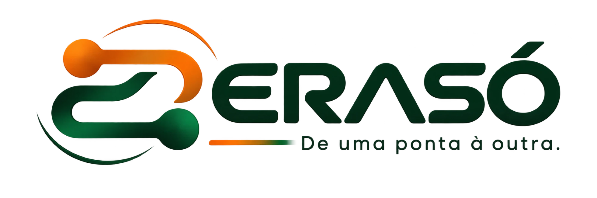
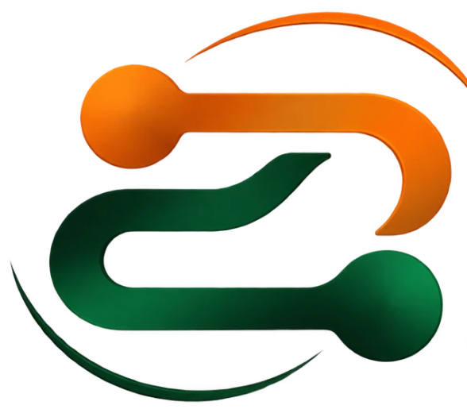

# DESIGN_SYSTEM — Erasó

<p align="left"></p>

> **Status:** direção aprovada em 01/11/2026 e **sincronizada com a logo oficial** (revisão 2). Nada foi implementado.
> Valores concretos em [DESIGN_TOKENS.md](DESIGN_TOKENS.md); componentes em [COMPONENT_INVENTORY.md](COMPONENT_INVENTORY.md); movimento em [MOTION_SPEC.md](MOTION_SPEC.md); escopo funcional em [ADAPTATION_PLAN.md](ADAPTATION_PLAN.md).
> Marcadores de evidência: **[O]** observado · **[I]** inferido · **[P]** proposto · **[?]** desconhecido.

---

## 1. Conceito

### 1.1 Ideia central — *Revezamento*

O produto é um **revezamento** entre os seus aparelhos: o conteúdo é passado adiante de mão em mão, sem perder o ritmo. Quando os aparelhos estão perto, a passagem é direta (rede local). Quando estão longe, a passagem segue por outro caminho (rota remota) — mas o gesto do usuário é sempre o mesmo.

A logo oficial já expressa esse conceito — **um nó laranja (partida) ligado por um caminho a um nó verde (chegada)**, com a assinatura **"De uma ponta à outra."** O sistema visual é derivado diretamente dela:

1. **A trilha** = o caminho da logo. Uma linha de pontas arredondadas que liga o aparelho de origem ao de destino é o motivo gráfico recorrente (painel de envio, doca de transferências, pareamento, estados vazios).
2. **A brasa** = o nó laranja (`#F76100`, amostrado da logo). Marca *o que está sendo passado* e *a próxima ação*. Nunca é decoração: se o laranja aparece, algo está acontecendo ou pode acontecer.
3. **A floresta** = o nó verde e o letreiro (`#004F29` / `#022C17`). Marca a **identidade** e a **chegada**: concluído, recebido, aparelho verificado.
4. **O grafite-mata** — neutros calmos com um viés verde quase imperceptível (papel `#F6F7F4` no claro, `#111311` no escuro), parentes do letreiro, deixam o laranja e o conteúdo do usuário em primeiro plano.

Em resumo: **laranja = em trânsito / ação · verde = chegou / confiável.** A mesma leitura do símbolo, da esquerda-acima (laranja) para a direita-abaixo (verde).

### 1.2 Posicionamento em relação às referências

| | LocalSend | Linear | Raycast | Dropbox | **Erasó [P]** |
|---|---|---|---|---|---|
| Matiz de marca | Teal (semente Material) **[O]** | Índigo `#5E6AD2` / `#7170FF` **[O]** | Vermelho-coral `#FF6363` **[O]** | Azul `#0061FE` **[O]** | **Laranja `#F76100` + verde-floresta `#022C17`** (da logo) |
| Neutros | Brancos esverdeados | Cinzas frios quase pretos (`#08090A`) **[O]** | Pretos frios (`#07080A`) **[O]** | Off-white quente (`#F7F5F2`) **[O]** | **Grafite-mata** (`#111311`) e **papel** (`#F6F7F4`) |
| Tipografia | Fonte do sistema **[O]** | Inter Variable, peso 510 **[O]** | Inter + Geist Mono **[O]** | Sharp Grotesk + Atlas Grotesk **[O]** | **Instrument Sans** + **Lexend** (só títulos) + **IBM Plex Mono** |
| Raios | 5 / 10 px **[O]** | 4–32 px, pílula em CTAs **[O]** | 4–24 px, botões 8 px **[O]** | — | **4 / 6 / 10 / 14 / 20**, pontas redondas como na logo |
| Personalidade | Amigável, utilitário | Preciso, editorial | Rápido, "teclado-primeiro" | Organizado, caloroso | **Caloroso e preciso: "de uma ponta à outra"** |

O resultado é deliberadamente diferente das quatro marcas: nenhuma delas usa o par laranja + verde-floresta, e a identidade parte da logo própria do projeto. O LocalSend também usa um verde-azulado (teal) como cor de marca **[O]**, mas o verde do Erasó é um verde-floresta quase preto no letreiro, combinado ao laranja — a semelhança fica restrita à família de matiz.

---

## 2. Princípios de design

| # | Princípio | Na prática | Herança |
|---|---|---|---|
| 1 | **Dois toques para compartilhar** | Abrir → selecionar (ou soltar/colar) → tocar no destino. Nenhuma tela intermediária obrigatória. | LocalSend |
| 2 | **O estado está sempre à vista** | Visibilidade deste aparelho, rota (local/remota), presença dos destinos e transferências ativas ficam visíveis sem abrir menus. | LocalSend + Dropbox |
| 3 | **Hierarquia por contraste, não por ornamento** | Diferenciar com peso, tom de texto (4 níveis) e espaço — não com bordas pesadas, sombras ou cores extras. | Linear |
| 4 | **Teclado de primeira classe, toque de primeira classe** | Tudo acessível por Ctrl/⌘+K e Tab; tudo alcançável com o polegar no celular. | Raycast + LocalSend |
| 5 | **Conteúdo é o herói** | Miniaturas, nomes e metadados do usuário recebem o espaço; o "chrome" do app recua. | Dropbox |
| 6 | **Confiança explícita** | Quem envia, por qual rota, com que verificação — dito em linguagem simples, nunca escondido. | LocalSend |
| 7 | **Calma por padrão, movimento com propósito** | Animações curtas, só para orientar (de onde veio, para onde foi, o que mudou). | Linear + LocalSend |
| 8 | **Inclusivo antes de sofisticado** | Rótulos sempre visíveis na navegação, alvos ≥ 44 px, contraste AA, textos simples. Sofisticação nunca às custas de clareza. | Projeto de extensão |

---

## 3. O que cada referência ensina

### 3.1 LocalSend — simplicidade operacional *(análise completa em [ADAPTATION_PLAN §1](ADAPTATION_PLAN.md#1-análise-do-localsend))*

- **Extraído:** fluxo seleção → destino; identidade do aparelho como elemento de destaque (apelido em 48 px **[O]**); pedido de recebimento com remetente em evidência; mensagens de erro específicas; personalização escondida em "Avançado".
- **Não extraído:** o visual Material genérico, o logotipo tracejado, os apelidos "Adjetivo + Fruta", a coluna fixa de 600 px no desktop.

### 3.2 Linear — sofisticação e hierarquia

Evidências coletadas em linear.app (estilos computados e variáveis CSS, 01/11/2026):

| Aspecto | Observado **[O]** | Princípio extraído **[P]** |
|---|---|---|
| Superfícies | Fundo `#08090A`; níveis `#0F1011`, `#141516`, `#191A1B`; secundárias `#1C1C1F`, `#232326`, `#28282C` | Elevação no escuro por **degraus de luminosidade**, não por sombra. |
| Texto | 4 níveis: `#F7F8F8`, `#D0D6E0`, `#8A8F98`, `#62666D` | Hierarquia em **quatro tons de texto** é suficiente para quase tudo. |
| Bordas | Primária `#23252A`, translúcidas `#FFFFFF0D` / `#FFFFFF14`; espessura "hairline" 1 px | Bordas finíssimas e translúcidas separam sem pesar. |
| Tipografia | Inter Variable; pesos 400 / **510** / 590 / 680; corpo 15 px; pequeno 13 px; títulos com *tracking* negativo (−1,4 px em 64 px) | Pesos intermediários e *tracking* negativo em títulos dão refinamento. |
| Raios | 4, 6, 8, 12, 16, 24, 32, pílula | Escala curta e consistente. |
| Movimento | `--speed-quickTransition: .1s`, `--speed-regularTransition: .25s`, destaque some em `.15s`; curvas *ease-out* quad→expo nomeadas | Duas velocidades cobrem a maioria das interações. |
| Foco | Anel de 2 px, deslocamento 2 px, cor índigo | Anel de foco visível e coerente com a marca. |
| Camadas | Escala de `z-index` nomeada (popover 600, paleta de comandos 650, diálogo 700, *toast* 800, *tooltip* 1100) | Empilhamento previsível por nome, não por número mágico. |
| Composição (mockup) | Barra lateral com seções recolhíveis ("Workspace", "Favorites"), item ativo com fundo sutil, conteúdo em coluna, painel lateral de detalhe | Navegação lateral densa + painel de detalhe. |
| Toque | `--min-tap-size: 44px` | Alvo mínimo de 44 px. |

### 3.3 Raycast — produtividade e interação

Evidências em raycast.com (estilos computados, variáveis CSS e mockups do produto):

| Aspecto | Observado **[O]** | Princípio extraído **[P]** |
|---|---|---|
| Paleta de comandos | Campo de busca no topo ("Type to filter entries…"), filtro de tipo à direita, lista agrupada ("Today") à esquerda, **painel de detalhe** à direita com metadados em pares rótulo/valor (Application, Content Type, Dimensions, Image Size) | Lista + detalhe com metadados tabulares para itens de conteúdo — ideal para Atividade e Caixa. |
| Barra de ações | Rodapé com contexto à esquerda e, à direita, **ação primária com tecla** (↵) e **"Actions ⌘K"** | Toda tela de lista mostra a ação principal e o atalho para "mais ações". |
| Teclas | `kbd` com borda `rgba(255,255,255,.15)`, raio 6 px, texto a 30% | Atalhos visíveis, mas discretos. |
| Superfícies | `#07080A` → `#101111` → `#18191A` → `#313133`; borda `#242728` | — |
| Tipografia | Inter; título 64/600; botões 14/500 com *tracking* +0,2 px; Geist Mono para dados técnicos | Fonte monoespaçada para dados técnicos (comando, tamanho, versão). |
| Botão | Fundo claro `#E6E6E6`, texto `#2F3031`, raio 8 px, sombra em camadas com brilho | Ação primária com volume sutil. |
| Espaço | Escala 4, 8, 12, 16, 20, 24, 32, 40, 48, 56, 64, 80, 96… | Escala de 4/8 px. |
| Cor de estado | Verde `#59D499`, vermelho `#FF6161`, amarelo `#FFC533`, azul `#57C1FF`, cada um com variante translúcida a 15% | Cada status tem par **sólido + fundo translúcido**. |
| Movimento | Curvas de mola definidas com `linear()` (`--spring-1`) | Mola leve para elementos que "chegam". |

### 3.4 Dropbox — organização e visualização de arquivos

Evidências em dropbox.com (mockup oficial do produto, variáveis CSS) e help.dropbox.com:

| Aspecto | Observado **[O]** | Princípio extraído **[P]** |
|---|---|---|
| Estrutura | Barra lateral (Início, Todos os arquivos, Favoritos, pastas), **busca** no topo, linha de **ações primárias em blocos** (Criar · Enviar · Criar pasta), **chips de filtro** (Recentes, PDF, Contratos, Desenhos), grade de miniaturas com nome + tipo · duração | Ações primárias como blocos grandes; filtros em chips; miniatura + 2 linhas de metadados. |
| Celular | Seções "Recentes", "Compartilhado", "Links visualizados" com "Ver todos"; status de sincronização por item (marca verde); barra inferior com botão central "+" | Status de sincronização **por item**, no mesmo lugar sempre. |
| Ícones de sincronização | Marca verde = sincronizado/disponível *offline*; nuvem com contorno = só *online*; setas circulares = enviando/baixando/aguardando; variações por plataforma | Um ícone de estado fixo por item, com significado estável. |
| Cores semânticas | Pares por papel: *alert* `#9B0032`, *attention* `#0061FE`, *success* `#2D7A02`, *warning* `#9B6400`, cada um com `background` (12–24% de opacidade), `border` e `border--faint` | Status = texto + borda + fundo translúcido, também no tema invertido. |
| Neutros | Papel `#F7F5F2`, elevado `#FBFAF9`, texto `#1E1919`, texto fraco `#524A3ED1` | Neutros levemente quentes humanizam a interface. |
| Tipografia | Sharp Grotesk (títulos) + Atlas Grotesk (texto) | Par título/texto com papéis claros. |
| Espaço | Unidade base 8 px (4, 8, 12, 16, 20, 24, 32, 40) | — |

### 3.5 Síntese — o que entra no Erasó

| De | Princípio | Onde aparece |
|---|---|---|
| LocalSend | Fluxo em dois toques; pedido explícito; identidade do aparelho destacada | Compartilhar, Pedido de recebimento, cartão "Este aparelho" |
| Linear | 4 tons de texto; elevação por luminosidade; bordas finas; duas velocidades de movimento; anel de foco | Todos os temas e componentes |
| Raycast | Paleta de comandos; lista + detalhe; barra de ações com atalho; mono para dados técnicos | Paleta, Atividade, Caixa, Dispositivos |
| Dropbox | Blocos de ação primária; chips de filtro; miniatura + metadados; status por item; status em pares | Compositor, Atividade, Caixa, Doca |

---

## 4. Direção visual

**"Ferramenta de bolso, bem-acabada."** Superfícies calmas e foscas, cantos suaves (não pílulas em tudo), contraste alto de texto, uma única cor quente para ação, ícones de traço, números em fonte mono. Nada de gradientes decorativos, *glassmorphism* ou ilustrações chamativas na área de trabalho.

| Atributo | É | Não é |
|---|---|---|
| Tom | Caloroso, direto, confiável | Infantil, corporativo, "gamer" |
| Densidade | Média no desktop, confortável no celular | Espremida (planilha) ou vazia (coluna de 600 px) |
| Cor | Neutros + 1 acento + cores de estado semânticas | Arco-íris, cor por seção |
| Forma | Raios 10–14 px em controles e cartões; 20 px em folhas e diálogos | Tudo pílula; cantos vivos |
| Profundidade | 2–3 níveis de superfície; sombra só em sobreposições | Sombras em todo cartão |
| Movimento | 90–280 ms, com propósito | Animações decorativas, giros contínuos |

### 4.1 Identidade

- **Nome:** **Erasó** (confirmado pela logo oficial).
- **Assinatura:** **"De uma ponta à outra."** — vira a âncora da voz do produto (primeiro uso, Sobre o projeto, estados de conclusão).
- **Apelidos de aparelho:** gerador próprio em pt-BR combinando fauna/flora brasileira e um adjetivo ("Ipê Sereno", "Arara Atenta", "Buriti Ágil"). Reforça o vínculo com sustentabilidade sem copiar o padrão de frutas do LocalSend.
- **Assinatura visual na interface:** a **trilha** — derivada do caminho da logo — com nó laranja na origem e nó verde no destino. Aparece no painel de envio, na doca de transferências, no pareamento e no estado vazio de "Por perto".

### 4.2 Logo oficial

| | |
|---|---|
|  |  |
| **Horizontal** (símbolo + letreiro + assinatura) — [assets/erasó-logo-horizontal.png](assets/erasó-logo-horizontal.png) | **Símbolo** (recorte de referência) — [assets/erasó-simbolo.png](assets/erasó-simbolo.png) |

**Anatomia [O — observado no arquivo]:**

| Parte | Descrição | Cor amostrada |
|---|---|---|
| Nó de partida | Círculo laranja, acima à esquerda, com sombra interna | `#F76100` (sombra `#A63802`) |
| Caminho laranja | Sai do nó, curva para a direita e para baixo | `#E26502`–`#D9710C` |
| Caminho verde | Entra pela esquerda e termina no nó de chegada | `#023E21`–`#066436` |
| Nó de chegada | Círculo verde, abaixo à direita, com brilho | `#004F29` (brilho `#0C884A`) |
| Órbitas | Dois arcos finos — laranja no alto, verde embaixo — envolvendo o símbolo | `#F86400` / `#02331C` |
| Letreiro | "ERASÓ" geométrico e largo, terminais arredondados, "A" sem barra | `#022C17` |
| Assinatura | Traço com gradiente laranja → verde + "De uma ponta à outra." com espaçamento largo | `#F76100` → `#0C884A`; texto `#022C17` |
| Fundo | Transparente (canal alfa) | — |

**Versões necessárias** (a produzir pelo responsável pela marca, em **vetor/SVG**; o arquivo atual é *raster* 2000 × 667 px com sombreamento):

| Versão | Uso | Observação |
|---|---|---|
| Horizontal com assinatura | Primeiro uso, Sobre o projeto, página de download, materiais do projeto | Mínimo 240 px de largura |
| Horizontal sem assinatura | Cabeçalho da barra lateral (28 px de altura), janela "Sobre", e-mails | Mínimo 120 px de largura |
| Símbolo completo | Ícone do app, tela de abertura, barra lateral recolhida, animação de sincronização | Mínimo 32 px |
| Símbolo simplificado (plano, sem órbitas e sem sombreamento) | Favicon, bandeja do sistema, barra de tarefas, notificações | 16–24 px: só os dois nós e o caminho |
| **Invertida para fundo escuro** | Tema escuro | **Obrigatória:** o letreiro `#022C17` tem **1,22 : 1** e o nó verde `#004F29` tem **1,91 : 1** sobre o canvas escuro (calculado). Letreiro em `#ECEFEA`, verdes em `#5CD08F` (9,67 : 1), laranjas mantidos (5,92 : 1) |
| Monocromática | Impressão em uma cor, marca-d'água, contextos de alto contraste | Verde `#022C17` no claro / `#ECEFEA` no escuro |

**Regras de uso:**

- **Área de proteção:** em volta da logo, espaço livre mínimo igual ao **diâmetro do nó laranja**.
- **Sincronização das camadas para animação:** o SVG deve separar em grupos nomeados: `no-partida`, `caminho-laranja`, `caminho-verde`, `no-chegada`, `orbita-laranja`, `orbita-verde`, `letreiro`, `assinatura` (ver [MOTION_SPEC §6](MOTION_SPEC.md#6-sincronização-da-logo)).
- **Na interface**, a logo aparece em apenas **um lugar por tela**: cabeçalho da barra lateral (desktop) ou barra superior (celular). Dentro do app usa-se a versão **sem assinatura**; a assinatura só aparece em primeiro uso e Sobre.
- **Não fazer:** trocar as cores do laranja e do verde entre si; aplicar sobre fundo laranja ou verde; usar a versão colorida no tema escuro; adicionar sombras, contornos ou brilhos; distorcer proporções; girar a logo inteira; recriar o letreiro com uma fonte; usar a assinatura abaixo de 240 px.
- **Ícone do aplicativo:** símbolo sobre fundo `#F6F7F4` (claro) — nunca sobre o laranja; no macOS/Windows seguir as grades de ícone de cada sistema.

**Sincronização sutil do sistema com a logo (resumo):**

| Da logo | Para o sistema |
|---|---|
| Laranja do nó `#F76100` | `color.accent.fill` (ação, em trânsito) |
| Verde do nó/letreiro | `color.text.brand`, `status.success`, nó de destino da trilha |
| Caminho com pontas arredondadas | Trilha de transferência e ícones com `stroke-linecap: round` |
| Traço laranja → verde da assinatura | `gradient.brand`, usado **só** na conclusão de uma transferência e no primeiro uso |
| Órbitas | Pulso de descoberta e animação de sincronização (arcos que oscilam ±8°) |
| Geometria larga do letreiro | Lexend nos títulos de tela e no display; espaçamento largo da assinatura em `type.tagline` |
| Verde quase preto do letreiro | Viés verde muito leve nos neutros e nas sombras |

### 4.3 Integração dos ODS (discreta)

**[P]** Três pontos de contato, nunca na navegação principal:

1. **Selo no rodapé da barra lateral** (desktop) / no fim de Configurações (celular): logotipo da instituição/projeto de extensão + "Projeto de extensão · ODS" em texto terciário, levando a *Configurações › Sobre o projeto*. A logo Erasó fica no **topo** da barra lateral; o selo institucional, no **rodapé** — as duas nunca lado a lado.
2. **Cartão no primeiro uso** (último passo, dispensável): uma frase sobre o propósito do projeto e os ODS relacionados.
3. **Seção "Sobre o projeto"**: instituição, equipe, ODS e metas atendidas (com os ícones oficiais, seguindo as diretrizes da ONU — ver dúvida D8), como o produto contribui, contato.

As cores oficiais dos ODS **não** entram na paleta da interface; aparecem somente nos ícones oficiais dentro da seção institucional.

---

## 5. Regras de composição

### 5.1 Layout em regiões (desktop)

```
┌───────────┬──────────────────────────────────────┬───────────────┐
│ ◐ ERASÓ   │ Cabeçalho da tela (título · busca ·  │               │
│ (logo)    │ ações)                               │  Inspetor     │
│ 240 px    ├──────────────────────────────────────┤  360 px       │
│           │                                      │  (≥ 1280 px)  │
│ Este      │ Conteúdo                             │               │
│ aparelho  │ (máx. 880 px de leitura; grades      │  detalhes do  │
│ ───────   │  ocupam a largura disponível)        │  item/aparelho│
│ Navegação │                                      │               │
│           │                                      │               │
│ Selo ODS  │                        ┌───────────┐ │               │
│           │                        │ Doca      │ │               │
└───────────┴────────────────────────┴───────────┴─┴───────────────┘
```

- **Barra lateral 240 px** (recolhível para 64 px); **inspetor 360 px** só a partir de 1280 px; abaixo disso, o detalhe abre em folha/diálogo.
- **Coluna de leitura** (texto corrido, configurações): máx. 720 px. **Grades** (destinos, Caixa) usam toda a largura com colunas mínimas de 220 px.
- **Margens da página:** 16 px (celular), 24 px (tablet), 32 px (desktop).

### 5.2 Tela Compartilhar (início) — ordem de leitura

1. **Este aparelho** — nome, tipo, visibilidade (Visível / Oculto) e recebimento automático. *Responde: "posso receber agora?"*
2. **Compositor** — área de soltura + blocos de origem (Arquivo · Pasta · Mídia · Texto · Link · Colar) + seleção atual (miniaturas, contagem, tamanho) + modo (Um destino · Vários · Link). *Responde: "o que vou mandar?"*
3. **Destinos** — abas-filtro *Meus aparelhos · Por perto · Favoritos*; grade de cartões com presença e rota; ações *Buscar novamente* e *Adicionar por endereço*. *Responde: "para quem?"*

No celular a ordem é a mesma, em coluna; o compositor recolhe para uma barra quando há seleção, para que os destinos fiquem ao alcance do polegar.

### 5.3 Regras gerais

- **Uma ação primária por região.** O botão brasa aparece no máximo uma vez por região visível (ex.: "Enviar" no compositor; "Aceitar" no pedido).
- **Rótulo antes de ícone.** Ícone sozinho só quando o significado é universal (fechar, mais opções, buscar) **e** há *tooltip* + `aria-label`.
- **Metadados em linha secundária**, sempre na ordem: *tipo · tamanho · origem/destino · quando*.
- **Números técnicos** (tamanho, velocidade, IP, porta, impressão digital) em fonte mono com algarismos tabulares.
- **Estados nunca dependem só de cor:** rota, presença e status sempre com ícone + texto.
- **Diálogos só para decisões** (aceitar pedido, confirmar exclusão, parear). Detalhes vão para inspetor/folha.

---

## 6. Hierarquia

| Nível | Uso | Estilo (ver *tokens*) |
|---|---|---|
| **H-Display** | Nome do aparelho no pedido de recebimento e no pareamento | `type.display` 32 px/600, *tracking* −0,02 em |
| **H1** | Título da tela | `type.title-lg` 24 px/600 |
| **H2** | Seção ("Destinos", "Hoje") | `type.title-sm` 17 px/600 |
| **H3 / rótulo de grupo** | Cabeçalhos de lista, grupos da barra lateral | `type.label` 12 px/600, maiúsculas pequenas *não* — usar caixa normal com cor terciária |
| **Corpo** | Texto e nomes de itens | `type.body` 15 px/400 (16 px no celular) |
| **Metadado** | Linha secundária | `type.small` 13 px/400, `text.secondary` |
| **Dado técnico** | Tamanho, velocidade, IP, código | `type.mono-sm` 13 px/450 |

Tons de texto: **primário** (conteúdo, títulos) → **secundário** (metadados, descrições) → **terciário** (dicas, rótulos de grupo, placeholders) → **desabilitado**.

---

## 7. Tipografia

| Papel | Família | Motivo |
|---|---|---|
| Títulos de tela e display | **Lexend** (SIL OFL) — só em `type.display`, `type.title-lg` e `type.tagline` | Geométrica e larga, ecoa o letreiro "ERASÓ" sem imitá-lo; desenhada com foco em legibilidade. *A validar; alternativa: Instrument Sans também nos títulos.* |
| Interface e textos | **Instrument Sans** (variável, SIL OFL) | Grotesca contemporânea com mais personalidade que Inter (usada por Linear, Raycast e pelo site do LocalSend), excelente em pt-BR (acentos), eixo de largura útil para rótulos compactos. |
| Dados técnicos | **IBM Plex Mono** (SIL OFL) | Legível em tamanhos pequenos, distinta da Geist Mono (Raycast) e da Berkeley Mono (Linear). |
| *Fallback* | `system-ui, "Segoe UI", Roboto, "Helvetica Neue", Arial, sans-serif` | Funciona *offline* e em máquinas de laboratório. |

Regras:
- Corpo **15 px no desktop, 16 px no celular** (evita *zoom* automático no iOS e melhora a leitura).
- Pesos: 400 (texto), 500 (rótulos e botões), 600 (títulos). 700 só em números de destaque.
- *Tracking* negativo apenas ≥ 24 px; positivo leve (+0,01 em) em rótulos de 12 px.
- Algarismos tabulares (`font-variant-numeric: tabular-nums`) em progresso, tamanhos e horários. **A verificar na implementação:** suporte a `tnum` na Instrument Sans; se ausente, esses números usam a Plex Mono.
- Comprimento de linha: 45–75 caracteres em textos corridos.
- Fontes **empacotadas com o app** (sem depender de CDN), por funcionarem sem internet — coerente com o uso em rede local.

---

## 8. Cores

### 8.1 Papéis

| Papel | Claro | Escuro | Uso |
|---|---|---|---|
| **Brasa (acento, da logo)** | preenchimento `#F76100` com texto `#1A1105`; texto/ícone `#A63802` | preenchimento `#FF6B05` com texto `#1A1105`; texto `#FF8A3D` | Ação primária, seleção, item em trânsito, foco. |
| **Floresta (marca, da logo)** | letreiro/títulos de marca `#022C17`; preenchimento `#004F29` com texto branco | `#5CD08F` (marca) · preenchimento `#3DBE78` com texto escuro | Identidade, conclusão, aparelho verificado. Não é cor de ação. |
| **Canvas** | `#F6F7F4` (papel) | `#111311` (grafite-mata) | Fundo da aplicação. |
| **Superfície** | `#FFFFFF` | `#181B18` | Cartões, painéis. |
| **Superfície elevada** | `#FFFFFF` + sombra | `#1F2320` | Menus, folhas, diálogos. |
| **Texto** | `#12201A` / `#525850` / `#666C64` | `#ECEFEA` / `#B2B8B0` / `#878D85` | Primário / secundário / terciário. |
| **Rota local** | `#0A6F80` (petróleo) | `#4CC3D6` | Conexão direta na mesma rede. |
| **Rota remota** | `#5A3FE0` | `#A594FF` | Conexão pela internet. |
| **Sucesso / Aviso / Erro / Info** | `#066436` (verde da logo) / `#8F5B00` / `#C4262E` / `#2563D9` | `#3DBE78` / `#F2B33D` / `#FF6B70` / `#6FA3FF` | Status, sempre com fundo translúcido + ícone. |
| **Gradiente de marca** | `#F76100 → #0C884A` | `#FF6B05 → #3DBE78` | Só na conclusão de transferência e no primeiro uso (como o traço da assinatura). |

### 8.2 Decisões e contraste (calculado, WCAG 2.x)

| Par | Razão | Resultado |
|---|---|---|
| Texto primário claro (`#12201A`) sobre canvas | 15,7 : 1 | AAA |
| Texto terciário claro (`#666C64`) sobre canvas / superfície / afundado | 5,0 / 5,4 / 4,7 : 1 | AA |
| Botão brasa claro (`#1A1105` sobre `#F76100`) | 5,9 : 1 | AA |
| Texto brasa claro (`#A63802`) sobre superfície | 6,6 : 1 | AA |
| Letreiro (`#022C17`) sobre canvas claro | 14,2 : 1 | AAA |
| Sucesso claro (`#066436`) / escuro (`#3DBE78`) sobre superfície | 7,3 / 7,3 : 1 | AAA |
| Texto terciário escuro (`#878D85`) sobre superfície / canvas | 5,1 / 5,5 : 1 | AA |
| Botão brasa escuro (`#1A1105` sobre `#FF6B05`) | 6,5 : 1 | AA |
| Rota local / remota — claro | 5,8 / 6,5 : 1 | AA |
| Rota local / remota — escuro | 8,3 / 6,9 : 1 | AA |
| Anel de foco claro (`#A63802`) / escuro (`#FF6B05`) contra canvas | 6,1 / 6,5 : 1 | ≥ 3 : 1 (componente) |
| Borda forte clara (`#8A9088`) / escura (`#6C726A`) contra superfície | 3,3 / 3,5 : 1 | ≥ 3 : 1 (componente) |
| Logo colorida sobre canvas escuro — letreiro / nó verde | 1,2 / 1,9 : 1 | ✖ → exige versão invertida |

Decisão-chave: **o botão primário usa texto escuro sobre o laranja da logo**, em ambos os temas. O laranja `#F76100` com texto branco fica em 3,15 : 1 — abaixo de AA para texto; escurecer o laranja tiraria a fidelidade à logo. Texto grafite sobre laranja é legível e vira assinatura do produto.

### 8.3 Temas

- **Sistema** (padrão), **Claro**, **Escuro** e **Alto contraste** (P2: bordas fortes, texto primário em todos os níveis, sem fundos translúcidos).
- O tema claro é um papel com viés verde quase imperceptível; o escuro é grafite-mata — não preto puro, para reduzir o "halo" de texto em telas OLED de baixo custo. A logo troca automaticamente para a versão invertida no tema escuro.

---

## 9. Iconografia

- **Estilo:** traço contínuo de **1,75 px** em grade de 24 px, terminais arredondados, cantos com raio de 2 px. Preenchido **somente** para estado ativo/selecionado (ex.: favorito marcado). O LocalSend usa ícones Material preenchidos **[O]** — o traço diferencia.
- **Biblioteca sugerida:** Lucide (licença ISC) como base, com ícones próprios para: símbolo do app, **rota local**, **rota remota**, **pareamento**, **caixa pessoal**. *Dependência a aprovar.*
- **Tamanhos:** 16 (inline/metadados), 20 (controles), 24 (navegação), 40 (cartão de aparelho), 56 (pedido de recebimento).
- **Ícones de tipo de aparelho:** celular, notebook, computador, tablet, navegador, servidor.
- **Ícones de tipo de conteúdo:** documento, imagem, vídeo, áudio, compactado, pasta, texto, link, desconhecido — cada um com cor de fundo neutra; a miniatura real substitui o ícone sempre que existir.

---

## 10. Acessibilidade (requisitos, não sugestões)

1. **WCAG 2.2 AA** como piso: contraste (§8.2), foco visível (2 px + deslocamento 2 px), alvos ≥ 44 × 44 px (24 px mínimos absolutos em listas densas com espaçamento compensatório).
2. **Teclado:** ordem de foco lógica; `Esc` fecha/volta; atalhos documentados na paleta; sem armadilhas de foco; diálogos devolvem o foco ao elemento de origem.
3. **Leitores de tela:** HTML semântico e controles nativos; regiões `aria-live="polite"` para progresso (anúncios a cada 25%, não a cada byte) e `assertive` só para pedidos de recebimento e erros.
4. **Movimento reduzido** respeitado por padrão (ver [MOTION_SPEC §11](MOTION_SPEC.md#11-movimento-reduzido)).
5. **Linguagem simples em pt-BR:** verbos de ação ("Enviar", "Aceitar"), sem jargão de rede na interface principal ("mesma rede Wi-Fi" em vez de "sub-rede"); termos técnicos só em Diagnóstico.
6. **Não depender de cor, gesto ou *hover***: toda ação de *hover* tem equivalente visível ou no menu.
7. **Texto redimensionável até 200%** sem perda de função; layout reflui até 320 px de largura.
8. **Idioma:** `lang="pt-BR"`; estrutura pronta para i18n.

---

## 11. Voz e microcopy (diretrizes próprias)

| Faça | Evite |
|---|---|
| "Enviar para Ipê Sereno" | "Iniciar sessão de transferência" |
| "Ipê Sereno quer te enviar 3 arquivos" | Mensagens sem sujeito |
| "Não encontramos aparelhos por perto. Eles estão no mesmo Wi-Fi?" + ação "Diagnosticar" | "Falha na descoberta multicast" |
| "Enviado por rota remota · 12 MB/s" | Esconder a rota |
| Confirmações curtas: "Copiado", "Salvo em Downloads" | Diálogos para sucesso |

Todos os textos devem ser escritos do zero; nenhuma string do LocalSend é reutilizada.
